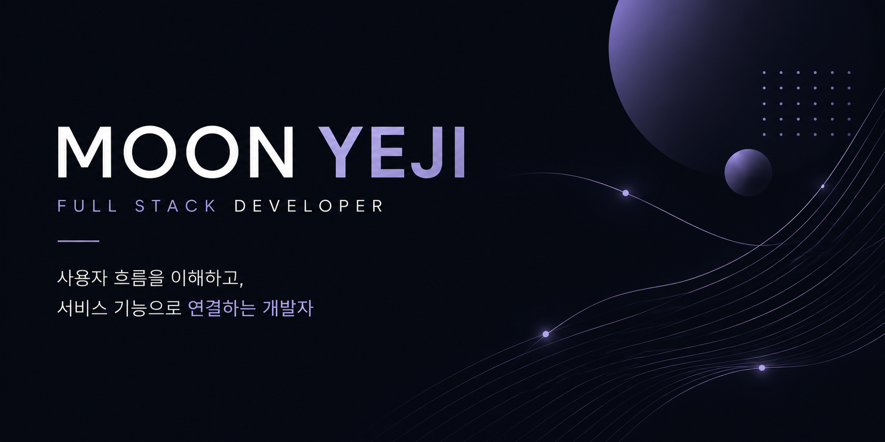
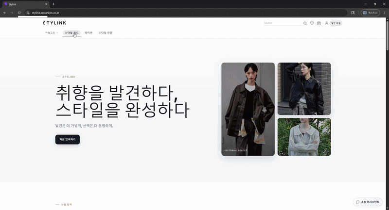
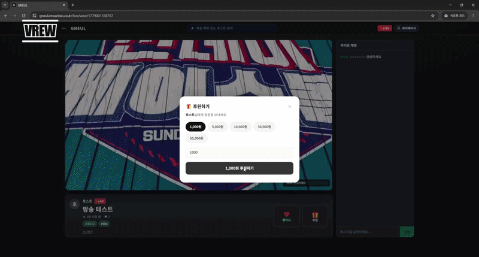

  

 

# 안녕하세요, 풀스택 개발자 문예지입니다 👋

React, Next.js, TypeScript, Spring Boot를 활용하여 프론트엔드와 백엔드를 개발하고 있습니다.

K-DAY 체험 예약 플랫폼의 주요 기능을 단독 개발했으며, Visit Korea에서는 회원 인증, 상품·콘텐츠 관리, 사용자 편의 기능 등을 담당했습니다.

사용자 화면부터 API, 데이터베이스까지 연결하는 풀스택 개발을 경험했으며, 개인·팀 프로젝트에서는 AWS 기반 배포 환경을 구성하고 실무에서는 GCP 기반 HTTPS 환경 설정과 클라우드 비용 분석을 수행했습니다.

 

## 🧑‍💻 About Me

| 구분 | 내용 |
|---|---|
| 이름 | 문예지 |
| 직무 | 풀스택 개발자 / 웹 개발자 |
| 주요 기술 | Next.js · TypeScript · React · Spring Boot · PostgreSQL · MySQL |
| 이메일 | herb6696@gmail.com |

 

## 🛠 Tech Stack

**Backend**  
    

**Frontend**  
     

**Database**  
  

**Realtime / API**  
     

**Tools / Infra**  
     

 

## 💡 What I Value

- 사용자 흐름을 기준으로 화면·API·데이터를 연결하는 개발
- 기능 구현뿐 아니라 운영 환경과 유지보수를 고려한 설계
- 인증·권한·사용자 상태에 따른 예외 흐름의 명확한 처리
- 문제의 원인과 대안을 확인한 뒤 개선 방향을 결정하는 태도
- UI/UX와 협업 과정까지 함께 고려하는 개발

 

# 📌 Projects

---

# 🌏 Visit Korea (실무)

> 외국인 관광객을 위한 여행·관광 통합 플랫폼  
> 회원 인증, 콘텐츠 CMS, 상품 탐색 및 사용자 편의 기능을 개발하고 클라우드 운영 비용 분석과 HTTPS 환경 설정을 수행했습니다.

 

## 🗓 Project Info

| 항목 | 내용 |
|---|---|
| 프로젝트 유형 | 실무 프로젝트 / 협업 개발 |
| 참여 시기 | 2026.09 ~ 현재 |
| 담당 역할 | 회원 인증 · 마이페이지 · 상품/콘텐츠 기능 · 관리자 기능 · 클라우드 설정 및 비용 분석 |
| 주요 기술 | Next.js · TypeScript · PostgreSQL · GCP |

 

## ✨ Main Features

| 기능 | 설명 |
|---|---|
| 회원 인증 | Google·LINE 소셜 로그인, 이메일 인증, 비밀번호 재설정 및 동일 이메일 계정 연동 |
| 회원 관리 | 마이페이지, 예약 내역, 찜, 계정 설정, 탈퇴 계정 접근 제한 |
| 장바구니 | 상품 담기·조회·삭제 및 관련 데이터 처리 |
| 메인 CMS | 히어로·NEWS·콘텐츠 섹션 관리자 데이터와 사용자 화면 연동 |
| 상품 탐색 | NOW·K-DAY 지역·가격·날짜 필터, 핫딜 목록 및 정렬 |
| 상품/콘텐츠 상세 | 바우처 권종 상세 공통화, 콘텐츠 상세 모달 및 이미지 표시 |
| 관리자 편의 기능 | 이미지 드래그 앤 드롭 등록 및 목록 화면 개선 |

 

## 🙋‍♀️ My Role

- 회원가입·로그인·계정 연동·탈퇴 기능의 프론트엔드 및 백엔드 개발
- 마이페이지와 장바구니 등 사용자 편의 기능 구현
- CMS 및 상품 목록·상세 기능의 관리자·사용자 화면 연동
- 바우처 상세 기능 공통화 및 이미지 관리 UI 개선
- GCP 비용 구조와 Cloud SQL DB 통합 시 예상 절감 효과 및 운영 영향 분석 후 PM에게 결과 공유
- Google Cloud 관리형 SSL 인증서를 직접 설정하여 HTTPS 환경 구성

 

## 🔍 Troubleshooting

| 문제 | 분석 및 대응 |
|---|---|
| 클라우드 운영 비용 증가 | GCP·Cloud SQL 비용 항목을 분석하고 DB 통합만으로 해결 가능한 범위와 운영상 영향을 비교해 PM에게 공유 |
| 인증 흐름 복잡성 | Google·LINE 로그인과 동일 이메일 계정 연동 및 탈퇴 상태별 접근 처리 구현 |
| 상세 화면 구조 중복 | 바우처 권종 상세 기능을 공통화하여 화면 구조와 유지보수 범위 정리 |
| HTTPS 운영 환경 구성 | Google Cloud 관리형 SSL 인증서를 직접 설정하여 별도 유료 인증서 구매 부담 완화 |

> 회사 프로젝트의 소스 코드와 내부 운영 자료는 공개하지 않습니다.

 

---

# 🎫 K-DAY (실무)

> 국내·외국인 대상 체험 상품 예약 플랫폼  
> 사용자 예약부터 상품·예약 관리자 기능까지 서비스의 주요 프론트엔드·백엔드 기능을 단독 개발했습니다.

 

## 🗓 Project Info

| 항목 | 내용 |
|---|---|
| 프로젝트 유형 | 실무 프로젝트 |
| 참여 시기 | 2026.07 ~ (주요 개발 및 운영 대응) |
| 개발 담당 | 1명 (본인) |
| 담당 역할 | 프론트엔드 · 백엔드 · 관리자 기능 개발 · 운영 요구사항 반영 |
| 주요 기술 | Next.js · TypeScript · PostgreSQL · GCP |

 

## ✨ Main Features

| 기능 | 설명 |
|---|---|
| 체험 상품 | 상품 조회 및 관리자 등록·수정 기능 |
| 국내 예약 | 날짜·시간 슬롯 기반 예약 흐름 |
| 외국인 예약 | 예약 요청 및 송금 방식에 따른 처리 흐름 |
| 예약 관리 | 관리자에서 예약 및 상품 정보 확인·관리 |
| 서비스 운영 | 실제 공방 요구사항 반영 및 데모·운영 환경 대응 |
| HTTPS | Google Cloud 관리형 SSL 인증서 설정 |

 

## 🙋‍♀️ My Role

- 예약·상품·관리자 기능의 프론트엔드 및 백엔드 단독 개발
- 국내·외국인 사용자별 예약 처리 흐름 구분 및 구현
- API·PostgreSQL 데이터 연동 및 관리자 기능 구성
- 공방 및 외부 업체와 요구사항 확인, 상품 데이터 확보
- Google Cloud 관리형 SSL 인증서 직접 설정
- 서비스 데모 및 운영 환경 배포·기능 개선 대응

 

## 🔍 Troubleshooting

| 문제 | 분석 및 대응 |
|---|---|
| 사용자 유형별 예약 방식 차이 | 국내 슬롯 예약과 외국인 예약 요청의 처리 흐름을 구분하여 구현 |
| SSL 인증서 도입 비용 | 외부 유료 인증서 대신 Google Cloud 관리형 SSL 인증서를 직접 설정하여 HTTPS 환경 구성 |

> 회사 프로젝트의 소스 코드와 내부 운영 자료는 공개하지 않습니다.

 

---

# 👗 STYLINK (개인)

> AI 기반 패션 커머스 통합 플랫폼  
> B2C 쇼핑 · B2B 도매관 · 피드 · 라이브 커머스 · AI 추천 기능을 하나의 서비스 흐름으로 연결한 개인 프로젝트입니다.

 

👉 **[STYLINK 상세 README 보러가기](https://github.com/herb2194/stylink/tree/dev)**

 

## 🔗 Links

| 구분 | 링크 |
|---|---|
| 배포사이트 | https://stylink.encanbio.co.kr |
| 노션 | https://www.notion.so/Portfolio-113b5864179e82ac9f2501056f285196?source=copy_link |
| PPT | https://drive.google.com/file/d/1QNe9MUIYwP69KQfYCklGnVARGt4g3dWn/view?usp=sharing |

 

## 🗓 Project Info

| 항목 | 내용 |
|---|---|
| 프로젝트 유형 | 개인 프로젝트 |
| 개발 기간 | 2026.04.08 ~ 2026.05.03 |
| 개발 인원 | 1명 |
| 담당 역할 | 기획 · 프론트엔드 · 백엔드 · DB 설계 · 주요 기능 구현 · 배포 |
| 주요 기술 | Spring Boot · React · TypeScript · MySQL · JWT · REST API |

 

## 🎬 Preview

> 스타일 피드에서 상품 상세 페이지까지 이어지는 커머스 탐색 흐름

 

## ✨ Main Features

| 기능 | 설명 |
|---|---|
| 사용자 인증 / 역할 관리 | 일반 사용자, 큐레이터, 소매 판매자, 도매 판매자, 관리자 역할 기반 접근 제어 |
| 상품 탐색 / 주문 흐름 | 상품 상세, 장바구니, 주문, 결제 완료 흐름 구현 |
| B2B 도매관 | 소매 판매자를 위한 도매 상품 탐색 및 공급 거래 구조 구현 |
| 스타일 피드 | 피드 작성, 조회, 상품 연결 기능 구현 |
| 라이브 커머스 | 라이브 허브, 라이브 시청, 판매자 라이브 스튜디오 구성 |
| AI 스타일 추천 | 취향 · 상황 · 스타일 기반 추천 기능 구현 |
| AI 쇼핑 어시스턴트 | 사용자 질문 기반 상품 탐색 보조 기능 구현 |
| 1:1 다이렉트 채팅 | 사용자와 판매자 간 실시간 문의 흐름 구현 |
| 관리자 기능 | 회원 · 상품 · 주문 · 권한 신청 관리 기능 구성 |

 

## 🙋‍♀️ My Role

- 프로젝트 전체 기획 및 서비스 구조 설계
- React 기반 주요 화면 구현
- Spring Boot 기반 API 구현
- JWT 기반 인증 및 역할별 권한 분리
- MySQL 기반 데이터 구조 설계
- 상품 · 주문 · 피드 · 라이브 · 관리자 기능 구현
- AWS EC2 · Nginx 기반 배포 환경 구성

 

## 🔍 Troubleshooting

| 문제 | 해결 |
|---|---|
| 역할별 접근 권한 혼동 | 프론트 보호 라우트와 JWT 기반 권한 검증을 함께 적용하여 역할별 접근 흐름 분리 |
| B2C / B2B 콘텐츠 혼재 | 사용자 역할과 공개 상태 기준으로 콘텐츠 노출 범위를 분리 |
| 관리자 기능 범위 불명확 | 운영 중심 관리자 구조로 역할과 UI 흐름 재설계 |

 

---

# 🏠 GNEUL (팀)

> 공간 대여와 라이브 스트리밍을 결합한 커머스형 플랫폼  
> WebRTC 기반 1:N 라이브 방송, 실시간 채팅, 예약·결제, 권한 승인 흐름을 구현한 팀 프로젝트입니다.

 

👉 **[GNEUL 상세 README 보러가기](https://github.com/herb2194/gneul)**

 

## 🔗 Links

| 구분 | 링크 |
|---|---|
| 배포사이트 | https://gneul.encanbio.co.kr |
| 노션 | https://www.notion.so/Portfolio-113b5864179e82ac9f2501056f285196?source=copy_link |
| PPT | https://drive.google.com/file/d/1HjIXcS49GLyqFbyoIdTygiP9uoa54pbY/view?usp=sharing |

 

## 🗓 Project Info

| 항목 | 내용 |
|---|---|
| 프로젝트 유형 | 팀 프로젝트 |
| 개발 기간 | 2026.03.09 ~ 2026.04.02 |
| 개발 인원 | 2명 |
| 담당 역할 | 파트 리드 · 실시간 서비스 · 결제 연동 · 채팅 · 포인트/리워드 · 라이브 기능 |
| 주요 기술 | Spring Boot · React · TypeScript · MySQL · Node.js · Socket.IO · WebRTC |

 

## 🎬 Preview

> 실시간 라이브 방송과 채팅, 도네이션 기능이 함께 동작하는 흐름

 

## ✨ Main Features

| 기능 | 설명 |
|---|---|
| 라이브 스트리밍 | WebRTC 기반 호스트 1명과 다수 시청자의 실시간 영상 연결 |
| 실시간 채팅 | 시청자와 호스트 간 실시간 채팅 기능 |
| 라이브 도네이션 | 후원 메시지와 함께 실시간 도네이션 기능 |
| 예약 결제 | 호스트 승인 후 진행되는 예약 결제 흐름 |
| 포인트 / 리워드 | 사용자 등급 기반 적립 및 리워드 구조 |
| 카카오 알림 | 결제 요청 · 예약 확정 · 권한 승인 알림 흐름 |
| HOST ↔ USER 1:1 채팅 | 개별 문의 및 상담 기능 |
| 방송 권한 신청 / 승인 | 관리자 승인 기반 방송 권한 구조 |

 

## 🙋‍♀️ My Role

- 팀 프로젝트 파트 리드로서 담당 기능의 프론트엔드·백엔드 개발 및 연동
- WebRTC 기반 1:N 라이브 스트리밍 기능 구현
- Socket.IO 기반 실시간 채팅 기능 구현
- PortOne 기반 결제 흐름 연동
- 포인트 및 리워드 정책 설계
- 카카오 알림 연동 흐름 구성
- HOST ↔ USER 1:1 채팅 기능 구현
- 방송 권한 신청 및 관리자 승인 흐름 설계
- 라이브 관련 프론트엔드 UI 구현
- 프로젝트 발표 및 PPT 제작

 

## 🔍 Troubleshooting

| 문제 | 해결 |
|---|---|
| 다중 시청자 연결 오류 | WebRTC offer·answer·ICE candidate 전달 흐름과 signaling 구조를 점검하여 Host ↔ Viewer 연결 흐름 개선 |
| 실시간 이벤트 충돌 | 라이브 / 1:1 채팅 Socket.IO 이벤트 흐름을 분리하여 이벤트 범위 명확화 |
| 결제 · 포인트 · 알림 순서 문제 | 상태 변경 → 포인트 적립 → 알림 발송 흐름으로 순차 처리 구조 구성 |

 

---

# 📚 Education & Learning

| 분야 | 학습 내용 |
|---|---|
| Java | 객체지향 프로그래밍 · 컬렉션 · 예외 처리 · 쓰레드 |
| Database | Oracle · MySQL · PostgreSQL · SQL · 관계형 데이터 모델링 |
| Backend | JSP · Servlet · Spring Boot · REST API |
| Frontend | React · Next.js · TypeScript · 컴포넌트 · State · 이벤트 처리 |
| Realtime | WebRTC · Socket.IO · 실시간 통신 구조 |
| Server | Node.js · Express · Router · Middleware |
| Infra | AWS · Docker · GCP 기반 배포·운영 환경 이해 |

 

## 📚 Currently Learning

- Next.js · TypeScript 기반 웹 애플리케이션 구조와 성능 개선
- PostgreSQL · SQL 쿼리 및 데이터 처리 최적화
- AWS·GCP 클라우드 인프라 및 서비스 운영 구조 이해
- 인증·권한 관리 및 웹 서비스 보안
- AI 개발 도구를 활용한 코드 분석 및 개발 생산성 개선

 

## 📫 Contact

- Email : herb6696@gmail.com
- GitHub : https://github.com/herb2194
- Portfolio : https://www.notion.so/Portfolio-113b5864179e82ac9f2501056f285196?source=copy_link

 

---

사용자 흐름을 이해하고,  
그 흐름을 실제 서비스 화면과 기능으로 구현하는 개발자가 되겠습니다.
